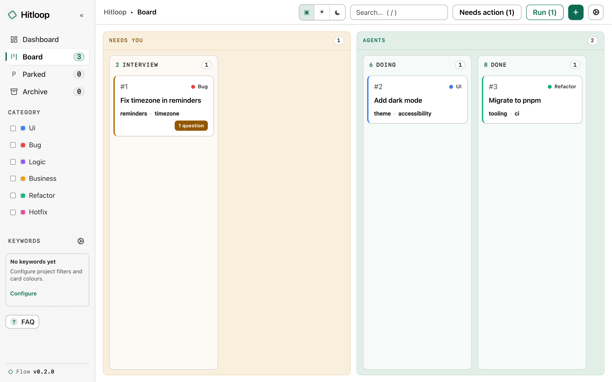
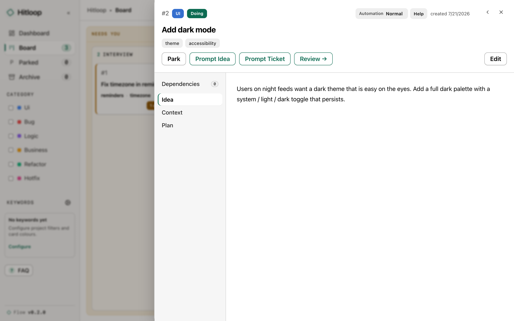
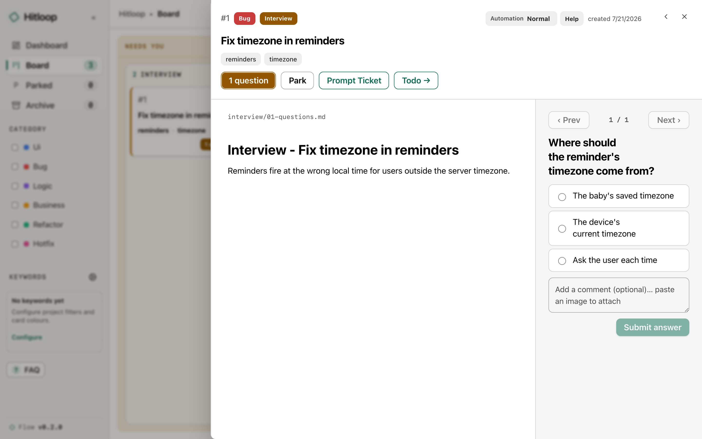

# local-filebased-agent-dashboard (lfad)

A dashboard for agent work that uses a folder in your project as the source of truth. Every ticket an agent works on becomes a self-contained folder of markdown notes and screenshots: the research, your decisions, the plan, the build notes and the evidence. You review the work from that folder, and months later it still tells you what was done and why.



Everything runs on your machine. A small daemon watches the `.agent-dashboard/` folder in your project and serves the board on localhost. The agent work happens in your own Claude Code or Codex session. There is no cloud service, no account and no agent running in the background on your bill.

## Contents

- [Why it exists](#why-it-exists)
- [One folder per ticket](#one-folder-per-ticket)
- [Decisions as questions](#decisions-as-questions)
- [One button runs the board](#one-button-runs-the-board)
- [The pipeline is data](#the-pipeline-is-data)
- [Getting started](#getting-started)
- [Growing a board to fit a project](#growing-a-board-to-fit-a-project)
- [Under the hood](#under-the-hood)
- [Keep in sync](#keep-in-sync)

## Why it exists

Agents are cheap and run in parallel, so your attention becomes the limit. With several pieces of work in flight, the usual failure is losing track: which task is at which stage, which one is quietly waiting on you, and where the context for each decision went.

The dashboard follows three rules:

1. **Work comes to you.** Tickets that need a person sit in a **Needs you** row. Everything else is agents working.
2. **You decide; you rarely compose.** Each point where the flow needs you is a question with options and a decision slot. You pick and annotate.
3. **Everything lives in one place.** A ticket carries every artefact of its own lifecycle as files in one folder, so a decision never means rebuilding context from five tools.

## One folder per ticket

The board folder is the only source of truth. A ticket is a folder that moves between step folders, and every step writes its output as markdown inside it:

```
doing/00042-add-csv-export/
  ticket.md          # frontmatter and the original idea
  context.md         # running hand-off state, rewritten at each step boundary
  research/          # findings: paths, patterns, constraints
  interview/         # the agent's restated understanding and your recorded decisions
  todo/              # the agent-ready breakdown
  doing/             # build notes: what changed, commits, test evidence
  images/            # screenshots of the built behaviour
```

`context.md` is the hand-off contract. It holds only paths, settled decisions and hard constraints. Whichever step finishes rewrites it, and whichever agent picks the ticket up next reads it first. Any agent, or you six weeks later, can resume a ticket from its folder alone.

The board is a live view of these files. The ticket drawer groups them and renders them as markdown:



Because the state is plain files:

- the board updates as soon as an agent writes (a file watcher and server-sent events);
- the board folder is its own git repo, and the daemon snapshots it before edits, so history is recoverable;
- deep links reach any file or heading (`/t/42/research/01-findings#api-shape`);
- there is no database to migrate or export.

## Decisions as questions

Agents pick *an* information architecture, *a* scope, *a* trade-off, and it may not be yours. Free-form chat spends your attention writing prose. The dashboard uses **gates** instead.

A step of `type: gate` (interview, design review, code review) is where an agent must stop. It writes its understanding plus the open choices as **question blocks**: a fenced block with typed options and an empty `**Decision:**` line.

````markdown
```question
id: theme-scope
ask: Should dark mode follow the system setting or expose a manual switch?
type: option
options: [system-follow, manual, both]
```
**Decision:**
````

The board renders these as a form at `/t/<id>/input`, with the control each type calls for: approve or reject, radio, checkboxes or free text. Your answer is written back into the `**Decision:**` line in the same format an agent or a hand edit would produce.



The interview gate keeps the question set small. The agent resolves implementation choices itself and records them as `Resolved by agent:` lines. Only the direction and information-architecture choices reach you.

## One button runs the board

The board is view-only. It never starts an agent and holds no API keys. Each action button **copies a command** to your clipboard. You paste it into your agent session, the skill there does the work and moves the ticket, and the board shows the changed files.

In practice you use one button, **Next**. It copies `/lfad:next <id>`, and the skill works out what the ticket's current step needs. Agent steps run and advance on their own. The loop stops at the next human gate, where you answer the open questions and press Next again.


One ticket, start to finish, is repeated Next:

```
idea → research → interview → mock? → design? → todo → doing → review → done
        agent      GATE       gate?   gate?     agent   agent   GATE
```


Code changes happen in a **per-ticket git worktree** of your project's repo, so an agent building ticket 42 never touches your working tree. When an agent reaches a decision it cannot make, the ticket moves to a **Blocked** column with a question block and returns to its step once you answer. Finished tickets go to a browsable archive. Tickets for later can be parked and restored where they left off.

## The pipeline is data

The steps above are the default. A board's pipeline, meaning its step keys, their order and how each behaves, is declared in that board's `board.yml`:

```yaml
steps:
  - key: doing
    label: Doing
    type: agent        # agent | gate | queue | terminal
    skill: lfad:build  # the skill that drives this step
  - key: review
    label: Review
    type: gate         # a person decides; the flow stops here
```

- `type` decides routing: `agent` steps run and advance, `gate` steps wait for you, `queue` passes through and `terminal` ends the pipeline.
- A step's `key` is its folder name. Array order is pipeline order.
- `skipUnless` applies a step only when a ticket flag is set. The default `mock` and `design` steps apply only to tickets marked `needsDesign`.
- Editing `board.yml` while the daemon runs reloads the pipeline without a restart. An invalid edit is rejected and the previous config stays.
- Skills write in English by default, in short, plain sentences. A board can override that without touching the plugin: `writing` sets the language of files a person reads and files an agent reads, `guidance` adds board or step rules, and `localRules` names a project rules file, by convention a project skill at `.claude/skills/lfad-local/SKILL.md`, that wins wherever it conflicts with the plugin's rules. `/lfad:override` puts each change in the right one of these places.

Every new board starts with the default nine-step pipeline. [`docs/board.example.yml`](./docs/board.example.yml) documents every option.

## Getting started

Requirements: Node 22+, pnpm, and [Claude Code](https://claude.com/claude-code) or [Codex](https://developers.openai.com/codex). Each project gets its own copy of the tool, cloned inside that project's board folder.

**1. Install into your project.**

```bash
git clone https://github.com/xhuang9/lfad.git <project>/.agent-dashboard/.lfad
cd <project>/.agent-dashboard/.lfad
pnpm install
pnpm bootstrap
```

The script is `pnpm bootstrap` because `setup` is a reserved pnpm command. It is safe to re-run and never wipes an existing board. It:

- builds the packages;
- creates `<project>/.agent-dashboard` with the default `board.yml` if none exists;
- runs `git init` on the board for local history;
- copies [`.env.example`](./.env.example) to `.env` if you have none;
- checks the result.

**2. Choose the skill prefix.** Skills run as `/lfad:up`, `/lfad:next` and so on. At a terminal, `pnpm bootstrap` asks for a prefix. To set it without the prompt, pass `pnpm bootstrap --prefix <name>`. For example, `--prefix flow` gives `/flow:up`. The choice is written into your local copy of the plugin manifests and is kept out of git, so `git pull` still updates cleanly.

**3. Install the plugin** so the skills are available in your agent.

Claude Code, using the copy you just cloned (this keeps your prefix):

```
/plugin marketplace add /absolute/path/to/<project>/.agent-dashboard/.lfad
/plugin install <prefix>@lfad
```

Codex:

```bash
codex plugin marketplace add /absolute/path/to/<project>/.agent-dashboard/.lfad
codex plugin add <prefix>@lfad
```

With the default prefix you can also install straight from GitHub: `/plugin marketplace add xhuang9/lfad`, then `/plugin install lfad@lfad`.

**4. Open the board.** In an agent session at your project root, run `/lfad:up` (Codex: `$lfad:up`). It starts the daemon against `<project>/.agent-dashboard` and opens `http://localhost:4319`. To try a throwaway sandbox first, run `pnpm demo`.

**5. Create your first ticket.** Tell your session what you want, for example `/lfad:idea add CSV export to the reports page`, then drive it with Next. The defaults are safe: `.env` ships with dry-run on, and nothing touches a code repo until you set `LFAD_CODE_REPO`.

Boards made before the rename to lfad keep working. A `.flow/` board with its tool in `.flow/.hitloop` is still found, and `HITLOOP_*` variables are still read when the `LFAD_*` ones are unset.

## Growing a board to fit a project

The default pipeline is a starting point. Here is how a board grows around a real project, a web app called `example-app`:

```
example-app/
  .agent-dashboard/   # the board (its own local git repo)
    .lfad/            # the installed tool
    board.yml
  src/ …              # the code the agents edit
```

**Add steps with `/lfad:add-step`.** After a few tickets you notice two recurring needs. Tests should be hardened after a person approves the diff, once its shape has settled. Finished work should be documented before it is archived. Two short interviews with the skill add:

- an `add-test` step (`type: agent`) between `review` and `done`, where approved code gets test coverage;
- a `doc` step (`type: agent`) after `done`, where shipped tickets get their knowledge written into the project's docs before archiving.

The skill writes the validated `board.yml` entries and creates the step folders. The running daemon reloads, and the new columns appear without a restart.

**Bind your own skills with `/lfad:add-skill`.** Generic steps need project rules. Your review step might require checking the change on a dev server. Your ship rule might be "merge to local main, never push". Describe the logic in plain language and the skill writes a project-local `SKILL.md` under `example-app/.claude/skills/`, keeping your rules word for word, including where the ticket moves when the skill finishes. It then binds the skill to the step's `actions` in `board.yml`.

After a few rounds the board reads:

```
idea → research → interview → mock? → design? → todo → doing → review → add-test → done → doc
                                                                  ↑            ↑           ↑
                                                             your review   your tests   your docs
                                                               rules         rules       rules
```

Operation stays the same: one button, the same gates. The pipeline now encodes how this project ships, and the rules live in skill files you own and can edit.

## Under the hood

A pnpm and Turborepo monorepo of three packages plus one agent plugin:

| Package | Role |
|---|---|
| `@lfad/core` | Ticket schema (Zod), the `board.yml` contract, file operations and validation. Filesystem only. |
| `@lfad/runtime` | The daemon: a Hono server with an in-memory index, file watcher, REST and SSE API, static UI serving, and the `flow` CLI. |
| `@lfad/ui` | The board: a Vite and React view-only UI, served as a built artefact on localhost. |

- **The daemon is the board's only git committer while it runs.** Content edits snapshot the previous state into the board's repo. Every operation is available over REST (`/api/tickets`, `/api/steps`, `/api/board`, SSE at `/api/events`) and through the `flow` CLI, which works when the daemon is down.
- **The lifecycle logic lives in skills.** How research runs, what the interview may ask and how tickets move are defined in the skill files under [`plugins/lfad/skills/`](./plugins/lfad/skills/). The engine handles folders, moves and parsing. The rules are markdown you can read and extend.
- **A dormant headless engine** is also in the runtime: adapter-configured CLI runs (any agent CLI that can print two sentinel lines), autopilot and dry-run limits. It has no UI. The routes still work for a cron job or orchestrator to drive over REST.

Developing the dashboard itself:

```bash
pnpm build       # build all packages
pnpm typecheck   # tsc --noEmit across packages
pnpm test        # vitest for core, runtime and ui; a fake agent, no real tokens
pnpm demo        # build, seed a sandbox board and serve it on :4319
```

Strict TypeScript, ESM, Node 22, no `any`.

## Keep in sync

Four files describe how the dashboard is installed and run, and they must match the code. A change to install, configuration, runtime behaviour, the `board.yml` contract, the CLI or the skills updates, in the same change:

1. this `README.md`;
2. the `/lfad:setup` skill ([`plugins/lfad/skills/setup/SKILL.md`](./plugins/lfad/skills/setup/SKILL.md)), plus `/lfad:up` if launch changes or `/lfad:add-step` if the `board.yml` schema changes;
3. [`.env.example`](./.env.example) when environment variables change;
4. [`docs/board.example.yml`](./docs/board.example.yml) when the config schema changes.

## Licence

MIT.
